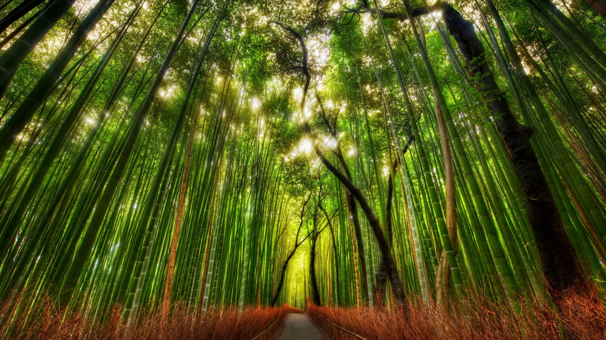
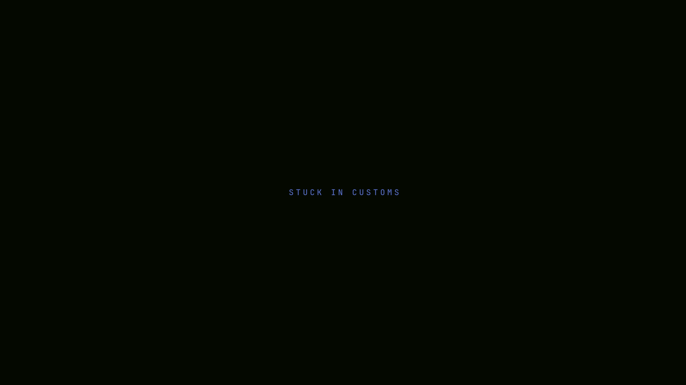

# Stuck In Customs — an Omarchy theme

An Omarchy theme for [Trey Ratcliff's portfolio](https://stuckincustoms.smugmug.com/Portfolio).
The palette is generated by **Aether** from the photographs rather than picked by
hand: a near-black with a green cast under the surfaces, parchment text, iris
blue as the accent and sea green as its counterweight.



Foreground/background contrast: **14.4:1**.

## Install

```bash
omarchy theme install https://github.com/cbeaujoin/omarchy-stuck-in-customs-theme
```

Omarchy clones the repo into `~/.config/omarchy/themes/stuck-in-customs` and
lists it as *Stuck In Customs*. Nothing gets dropped on install: the repository
ships colours, the icon set, previews, backgrounds and the unlock assets — no
`.lua`, terminal config or `vscode.json`, which is all Omarchy strips from
installed themes anyway.

If you would rather keep a working copy and apply it by hand:

```bash
git clone https://github.com/cbeaujoin/omarchy-stuck-in-customs-theme \
  ~/.config/omarchy/themes/stuck-in-customs
omarchy theme set "Stuck In Customs"
```

Either way the boot screen is separate from the desktop theme — see
[Unlock screen](#unlock-screen).

## What's here

| File | Purpose |
| --- | --- |
| `colors.toml` | the whole palette; every generated app config is built from it |
| `icons.theme` | Yaru-blue icon set |
| `unlock.png` | Plymouth boot logo — the Temple of Heaven gateway |
| `preview.jpg` | theme switcher preview |
| `preview-unlock.png` | unlock-screen preview, as the switcher renders it |
| `backgrounds/` | 28 wallpapers from the portfolio |

`alacritty.toml`, `ghostty.conf`, `btop.theme`, `hyprland.lua`, `shell.toml` and
friends are **not** checked in: Omarchy regenerates them from `colors.toml`
through `$OMARCHY_PATH/default/themed/*.tpl` on every `omarchy theme set`, which
is also why the theme keeps working after an update.

## Palette

| Token | Hex | Role |
| --- | --- | --- |
| `background` | `#040800` | near-black with a green cast, the base surface |
| `darker_background` | `#020400` | the same black, two stops down |
| `lighter_background` | `#1d211a` | raised surfaces (bar, menus, panels) |
| `accent` | `#5e76d5` | iris blue: focused controls, selection, highlights |
| `foreground` | `#d9dcc9` | parchment body text, never pure white |
| `cyan` | `#0ec2a6` | sea green, the accent's counterweight |
| `blue` | `#5e76d5` | the same iris blue as the accent |
| `magenta` | `#467fcd` | periwinkle, for the third ANSI slot |
| `green` | `#688900` | olive |
| `yellow` | `#e8db19` | acid yellow — the loudest colour in the set |
| `brown` | `#794739` | dried clay |

The focused window is drawn with a gradient border from iris blue to sea green,
set in `colors.toml`:

```toml
hyprland_active_border = "#5e76d5 #0ec2a6 45deg"
```

Two departures from Aether's raw export, both in `colors.toml`:

- `selection_foreground` — the export pairs it with the background colour
  (1.2:1, so selected text disappears). It is set to `bright_foreground` here
  (12.8:1 on `selection`).
- `hyprland_active_border` — the export does not define it, so it is composed
  here from the accent and the cyan.

`muted` (`#5a5d57`) is the one deliberately dim token: 3.0:1 on the background,
2.4:1 on `lighter_background`. Everything else that carries text is above 4.7:1.

## Backgrounds

Twenty-eight photographs, each rebuilt from the largest file SmugMug serves for
it (the `5K` rendition, or the original where that is bigger) and encoded as
WebP at 5120 px wide, so they are pixel-clean on a 5120×1440 display. The two
portrait/square frames — the Great Wall and the Space Shuttle — are cropped to
5120×1440 so they fill an ultrawide instead of losing their subject; everything
else keeps its native aspect.

`01-kyoto-bamboo-forest` is the one the theme opens on — Omarchy picks the
first file in sorted order — and it is also the shot in `preview.jpg`.

| File | Title on stuckincustoms.com |
| --- | --- |
| `01-kyoto-bamboo-forest` | 4070581709_a1c668a779_o (bamboo forest, Kyoto) |
| `02-queenstown-aurora` | Trey Ratcliff – Aurora Australis – Landing on the River – Queenstown |
| `03-triple-terra` | Day 17 – Triple Terra big (Manarola, Cinque Terre) |
| `04-venice-gondolas` | gondolafun (moored gondolas, Venice) |
| `05-crimson-sunset` | untitled (317 of 468)-Edit |
| `06-death-valley-mysterious-rocks` | Trey Ratcliff – Death Valley – Mysterious Rocks |
| `07-egypt-pyramids` | Egypt Fun (38 of 119)_HDR |
| `08-great-wall` | Great Wall (aerial, autumn) |
| `09-guangxi-province-china` | Deep in the Guangxi Province of China |
| `10-hawaii-waterfalls` | Trey Ratcliff – Hawaii – Pilot – Waterfalls |
| `11-hobbiton-fireplace` | Hobbiton Fireplace |
| `12-hong-kong-fun` | Hong Kong Fun (26 of 37) |
| `13-jules-verne-experiments` | where jules verne would perform experiments on animalkind |
| `14-kyoto-temple-blue-hour` | Untitled1_HDR copy (Kyoto at blue hour) |
| `15-lijiang-at-night` | Lijiang at Night |
| `16-lindis-pass` | Lindis (lupins, Lindis Pass) |
| `17-long-road-new-zealand` | The Long Road in NZ |
| `18-mighty-glacier` | Day 13 – Sunny Valley – The Mighty Glacier |
| `19-milford-sound` | trey-ratcliff-milford10 |
| `20-milford-sound-big-panorama` | untitled-102-Pano copy |
| `21-monet-pond` | Day 24 – Monet Det – (14 of 123)_HDR copy |
| `22-nameless-beach-spain` | Trey Ratcliff – Spain – Nameless Beach |
| `23-new-york-fun` | New York Fun (254 of 279) |
| `24-pink-sky` | Bonus – Pink Sky |
| `25-queenstown-balloon` | Trey Ratcliff – Stuck In Customs – 16 (balloon over Lake Wakatipu) |
| `26-shinjuku` | Trey Ratcliff – Series 2 – Shinjuku – 150cm |
| `27-space-shuttle` | Final Night of the Space Shuttle |
| `28-the-park` | thepark |

Filenames are lower-case descriptions of the scene; the numeric prefix only
keeps `omarchy theme bg next` walking them in a sensible order (and decides the
wallpaper a fresh install starts on).

## Rotating them

A theme that ships twenty-eight wallpapers should make cycling them easy. The
recommended way is [**Omarchy Background Switcher**](https://plugins.omarchy.org/plugin.html?id=adarsh.background-switcher),
a bar widget by Adarsh that previews this theme's backgrounds and rotates them
on a timer:

```bash
omarchy plugin add https://github.com/TheComputeCenter/omarchy-background-switcher --enable
omarchy bar move adarsh.background-switcher --section center --before omarchy.clock
```

It reads the same two folders Omarchy's own `omarchy theme bg` commands do —
`~/.local/state/omarchy/current/theme/backgrounds/` and
`~/.config/omarchy/backgrounds/<theme-name>/` — so these 28 files appear in it
untouched, in filename order, and any extra shots you drop into
`~/.config/omarchy/backgrounds/stuck-in-customs/` join them. It offers 5, 15, 30
and 60 minute intervals (or 1–1440 custom), a random order, and a Next
background button, and it switches with `omarchy theme bg set`, which does not
re-derive the palette — rotating a wallpaper never moves the colors.

Prefer that to a hand-rolled `systemd` timer: the widget only runs while the
shell is up, remembers its deadline across restarts, and stays in sync with
manual picks. Rotation is off until you turn it on.

## Unlock screen

The boot logo is Trey Ratcliff's *Approaching The Temple Of Heaven* — the gate
seen from inside the door, which is the right picture for a passphrase prompt.



It is not a wallpaper: Plymouth draws `logo.png` at its native pixel size,
centred and **never scaled**, over a flat background (the `background` token),
and places the passphrase field exactly 40 px below it. On a 5120×1440 panel a
full-bleed image would push that field off the bottom of the screen, so
`unlock.png` is a 1320×880 plate with a radial alpha fade, and the field lands
at y=1200 with room to spare. `preview-unlock.png` is the same plate composited
the way `omarchy plymouth preview` does it, at 1920×1080.

Themes with these two files are listed under *Appearance → Unlock*; the boot
screen is chosen separately from the desktop theme:

```bash
omarchy plymouth set by theme stuck-in-customs   # needs sudo
```

The photographs are **Trey Ratcliff's** — they are included only so the theme
has matching wallpapers for personal desktop use. The palette itself (a set of
hex values) is what this repository is really about.
